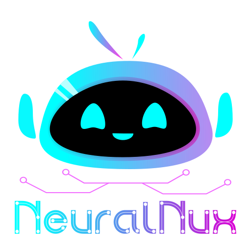

# NeuralNux Official Website

This repository branch contains the complete source code for the NeuralNux official website.  
The website serves as the public-facing platform for NeuralNux, showcasing the team’s mission, services, projects, and contact information.

The site is built using modern frontend technologies with a responsive, animated, and performance-optimized design, and is deployed using Vercel.

---

## Live Deployment

https://neural-nux.vercel.app

---

## Technologies Used

### Frontend

- HTML5 (Semantic structure)
- CSS3 (Custom styling + animations)
- JavaScript (Interactivity)

### Frameworks & Libraries

- Bootstrap 5 (Responsive layout & components)
- Bootstrap Icons (UI icons)
- Boxicons (Modern vector icons)
- AOS (Animate On Scroll effects)
- Swiper.js (Sliders & transitions)
- PureCounter.js (Animated statistics)

---

## Design & Fonts

- Modern cyber-tech visual theme
- Neon gradient styling for highlights
- Responsive typography
- Custom CSS for animations and layout transitions
- Vector-based icon fonts for scalability

---

## Deployment

The website is deployed using **Vercel** with automatic builds from GitHub.

### Deployment Flow:

1. Code pushed to `Website_Source_Code` branch
2. Vercel connected to GitHub repository
3. Static assets served directly by Vercel CDN
4. Automatic redeploy on each push

### Benefits:

- Global CDN
- High performance
- HTTPS enabled by default
- Continuous deployment

---

## Security & Best Practices

- No backend or exposed API keys
- Static asset hosting (minimal attack surface)
- HTTPS enforced by Vercel
- Clean folder separation for maintainability
- Relative asset paths to avoid broken resources
- Optimized font loading

- The project includes a vercel.json configuration to enhance browser-level security.
  
- Preventing the site from being embedded in iframes (protects against clickjacking attacks)
- Blocking browsers from interpreting files as unintended content types (reduces risk of malicious script execution)
- Limiting the amount of referrer information shared when navigating away from the site (improves user privacy)

---

## Responsiveness

The website is fully responsive and tested across:

- Desktop
- Mobile and Tablet will be included in the future. 

Bootstrap grid system ensures adaptive layouts.

---

## Performance Optimization

- Compressed images
- CDN-delivered assets via Vercel
- Font loading optimization
- Minimal JavaScript overhead

---

## Features

✔ Animated hero section  
✔ Smooth scrolling navigation  
✔ Services showcase  
✔ Team member profiles  
✔ FAQ accordion  
✔ Contact information cards  
✔ Modern footer with social links  
✔ Scroll-based animations  

---

##  Purpose

The NeuralNux website is designed to:

- Present NeuralNux as a professional innovation team  
- Showcase real-world projects  
- Promote workshops and collaborations  
- Provide contact and outreach platform  

---

---

Now here’s the **logo creation section** — this is VERY GOOD for portfolio value.

---

## Logo Design Process

The NeuralNux logo was custom-designed specifically for this project to reflect innovation, technology, and modern digital identity.

### Tools Used
- Inkscape (vector graphic design software)

### Design Workflow

1. Initial concept sketch focusing on futuristic and minimal style
2. Vector creation in Inkscape using scalable paths
3. Color palette selection aligned with the website theme
4. Exported in high-resolution PNG and SVG formats for web use
5. Optimized for fast loading and responsiveness

The logo is fully scalable and suitable for both digital and print media.

> Note: The NeuralNux logo and branding are proprietary and not permitted for reuse without authorization.

---

## Developed and Maintained By

May Mon Ko
NeuralNux Web Team  
Albukhary International University (AIU)

---

## License

This project is developed for academic and organizational showcase purposes.  
The website template may be reused for educational or personal projects; however, the NeuralNux name, branding, and logo must not be used without permission.

